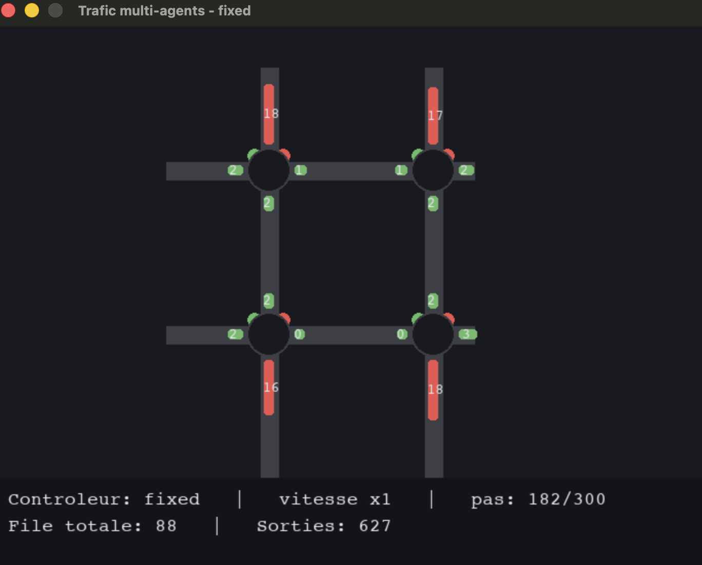
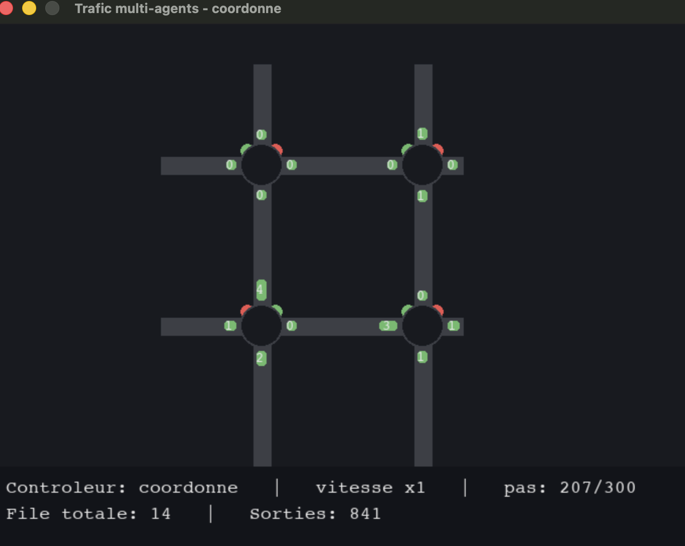
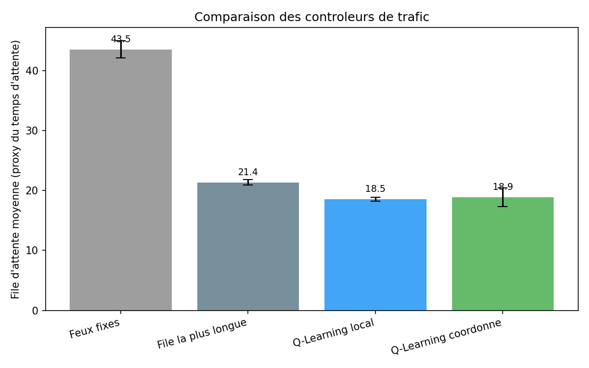
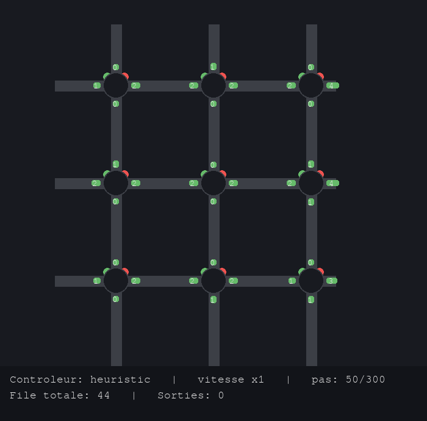

# Régulation intelligente de feux de circulation (Multi-Agent RL)

Un reseau de carrefours, chacun pilote par un agent qui **apprend** a
choisir sa phase de feu en fonction du trafic reel -- et non par une
minuterie fixe. Projet complet : simulation, 4 controleurs compares,
evaluation chiffree, visualisation temps reel.


*Feux fixes : file totale = 88 véhicules, 627 sorties au pas 182/300.*


*Q-Learning entraîné : file totale = 14 véhicules, 841 sorties au pas 207/300 — capture d'écran réelle, projet testé de bout en bout.*

## Résultat principal

Sur 30 episodes d'evaluation, les agents entraines par Q-Learning
**reduisent la congestion de 57 % par rapport a des feux fixes**, et
battent meme une heuristique reactive ("donner le vert a la file la plus
longue") de 13 % -- sans aucune regle ecrite a la main.

| Controleur | File d'attente moyenne | Debit (vehicules/episode) | Pic de congestion |
|---|---|---|---|
| Feux fixes | 43.51 | 1021.2 | 23.63 |
| File la plus longue (heuristique) | 21.36 | 1059.2 | 10.87 |
| **Q-Learning local** | **18.54** | **1063.8** | 11.53 |
| Q-Learning coordonne | 18.88 | 1063.4 | 13.27 |



*Chiffres reproductibles : `python train.py --mode local && python train.py --mode coordonne && python evaluate.py`.*

## Installation

```bash
git clone https://github.com/TON_PSEUDO/smart-traffic-marl.git
cd smart-traffic-marl

python3 -m venv venv
source venv/bin/activate        # Windows : venv\Scripts\activate
python -m pip install -r requirements.txt
```

## Utilisation

Les Q-tables sont deja entrainees et incluses dans `artifacts/qtables/` --
tu peux lancer la demo tout de suite, sans attendre d'entrainement.

```bash
# Voir un controleur en action (fenetre Pygame)
python visualize.py --controller fixed        # feux fixes
python visualize.py --controller heuristic    # file la plus longue
python visualize.py --controller local        # Q-Learning egoiste
python visualize.py --controller coordonne    # Q-Learning coordonne

# Ré-entrainer depuis zero
python train.py --mode local
python train.py --mode coordonne

# Ré-evaluer et regenerer les graphiques
python evaluate.py --episodes 30
```

### Contrôles de la fenêtre

| Touche | Action |
|---|---|
| `1` à `9` | Vitesse de simulation |
| `ESPACE` | Pause |
| `R` | Réinitialiser l'épisode |
| `ÉCHAP` | Quitter |

## Comment ça marche

Grille de carrefours, chacun avec 4 files d'attente (Nord/Sud/Est/Ouest).
Un agent Q-Learning par carrefour choisit sa phase de feu (axe Nord-Sud vert
ou axe Est-Ouest vert) en observant uniquement ses propres files. Deux
variantes de récompense sont comparées :

- **`local`** : chaque agent minimise uniquement sa propre congestion.
- **`coordonne`** : chaque agent tient aussi compte de la congestion de ses
  voisins directs.

C'est le prolongement naturel des deux projets précédents de la formation :
**Minimax Pong** (agents en compétition totale) et **Ball Sort IQL**
(agents coopératifs à récompense partagée). Ici, les deux paradigmes sont
comparés sur le même problème — voir [`docs/EXPLICATION.md`](docs/EXPLICATION.md)
pour l'explication complète, y compris un résultat inattendu et honnêtement
rapporté : sur une petite grille 2×2, la coordination n'apporte **pas**
d'amélioration, et pourquoi.

## Structure du projet

```
smart-traffic-marl/
├── README.md
├── requirements.txt
├── constants.py                 # tous les hyperparametres au meme endroit
├── env/
│   └── grid_env.py              # simulation : grille, files, trafic
├── agents/
│   └── q_learning_agent.py      # agent Q-Learning tabulaire
├── baselines/
│   ├── fixed_time.py            # feux a minuterie fixe
│   └── longest_queue.py         # heuristique "file la plus longue"
├── train.py                     # entrainement (--mode local|coordonne)
├── evaluate.py                  # comparaison chiffree des 4 controleurs
├── visualize.py                 # fenetre Pygame temps reel
├── artifacts/
│   ├── qtables/                 # Q-tables deja entrainees (pretes a l'emploi)
│   └── train_log_*.csv          # historique d'entrainement
├── results/
│   ├── comparison.csv
│   ├── comparison_queue.png
│   ├── comparison_throughput.png
│   └── learning_curves.png
├── docs/
│   └── EXPLICATION.md           # théorie complète, formules, limites
└── images/                      # captures d'écran (ce README)
```

## Limites connues

Simulation volontairement simplifiée pour rester robuste : pas de virages,
pas de phase orange explicite, pas de blocage amont entre carrefours.
Toutes les simplifications et leurs justifications sont détaillées dans
[`docs/EXPLICATION.md`](docs/EXPLICATION.md).

## Pour aller plus loin


*La simulation fonctionne déjà sur une grille plus grande (`--grid-size 3`), il reste à y entraîner des agents.*

- Tester `--grid-size 3` ou `4` pour vérifier si la coordination devient
  utile sur un réseau plus grand (hypothèse documentée dans les docs).
- Remplacer le Q-Learning tabulaire par un DQN pour passer à l'échelle.
- Calibrer les taux d'arrivée avec de vraies données de comptage routier.

## Auteur

**Tibtissam draoui ** — projet réalisé lors du module *Formation Multi-Agents*
[GitHub](https://github.com/dashboard) · [LinkedIn](https://www.linkedin.com/in/draoui-ibtissam-b59073388?utm_source=share_via&utm_content=profile&utm_medium=member_ios)
